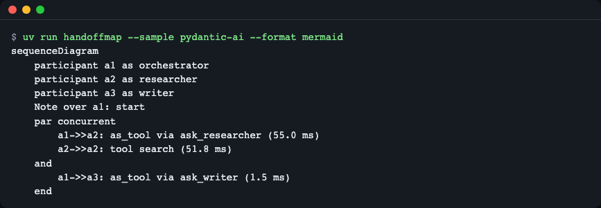
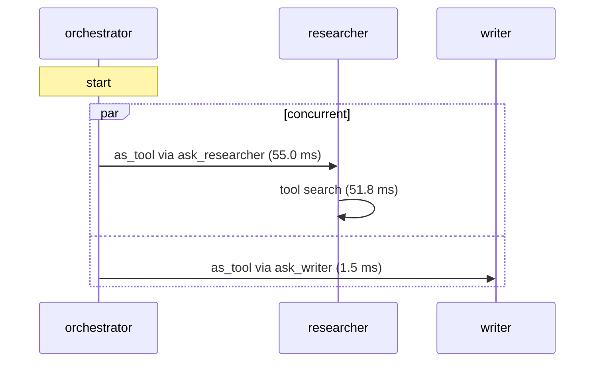
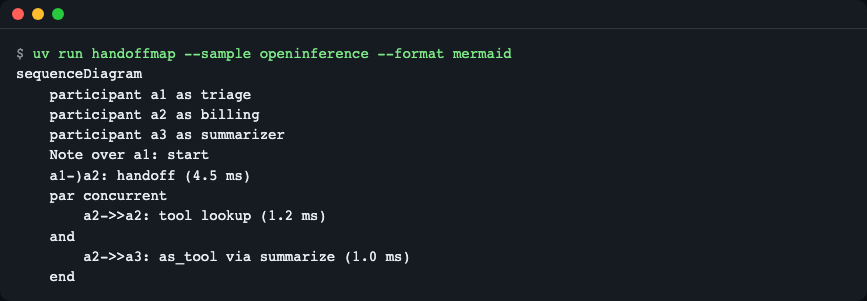
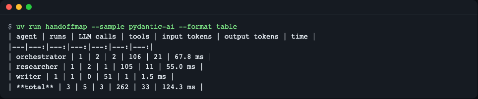
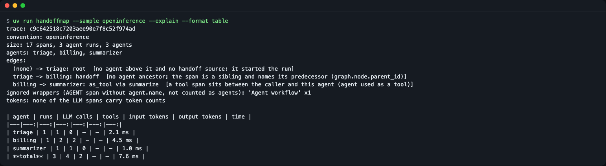
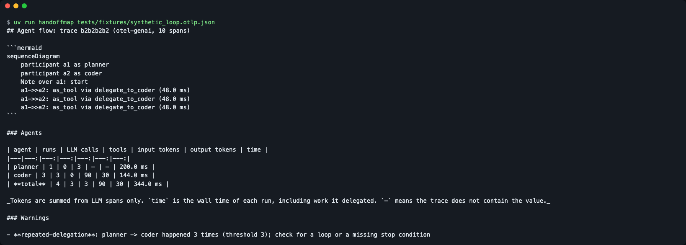
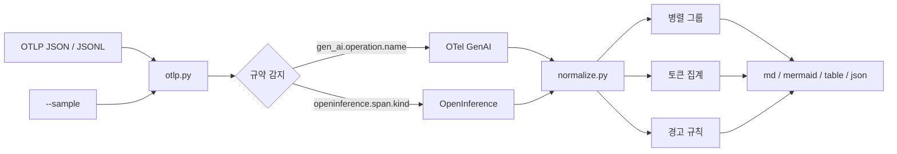

# handoffmap

> **English summary** — handoffmap folds an OpenTelemetry trace of a multi-agent run (OTel GenAI semantic conventions or OpenInference) into a Mermaid sequence diagram plus a per-agent table: who handed off to whom, who called whom as a tool, what ran in parallel, and how many tokens each agent used. It reads an OTLP JSON/JSONL file, needs no server and has zero runtime dependencies. Try it: `uv tool install git+https://github.com/LeeGyeongPil/handoffmap && handoffmap --sample pydantic-ai`.

에이전트 추적(span 트리) 수십 줄을 눈으로 접는 대신, 파일 하나로 **누가 누구에게 넘겼고, 누가 누구를 도구처럼 불렀고, 어디서 병렬로 돌았는지**를 Mermaid 순서도와 표로 뽑아 주는 CLI입니다. PR·이슈·README에 붙이면 GitHub이 그림으로 그려 줍니다.


*Pydantic AI로 만든 샘플 추적의 Mermaid 출력(원문; GitHub에서는 순서도로 그려집니다). orchestrator가 researcher와 writer를 도구로 동시에 불렀다는 것이 `par` 블록 하나로 보입니다.*

## handoffmap 이란

회의록(span 트리)을 처음부터 끝까지 읽는 대신 **조직도 + 타임라인 한 장**을 받는 것과 같습니다. 추적(trace)은 "어떤 일이 몇 시 몇 분에 시작해 끝났다"를 span이라는 조각으로 나열한 기록입니다. 에이전트가 많아지면 조각이 수십~수백 개가 되고, 정작 궁금한 것은 이런 질문입니다.

- 이 에이전트는 **넘기기(handoff)** 로 일을 받았나, **도구처럼 호출(as tool)** 되었나?
- 같은 위임이 반복되고 있지는 않나?
- 어디서 동시에 일했나?
- 에이전트별로 토큰을 얼마나 썼나?

이런 분께 맞습니다.
- Pydantic AI, OpenAI Agents SDK(+ OpenInference 계측)로 멀티 에이전트를 만들고, 실행이 이상한 이유를 보고 싶은 분
- 실행 한 번을 동료에게 설명하거나 PR에 붙이고 싶은 분
- 에이전트별 토큰을 CI에서 확인하고 싶은 분 (`--format json`)

## 빠른 시작

### 설치

PyPI 게시 전에는 GitHub에서 설치합니다.

```bash
curl -LsSf https://astral.sh/uv/install.sh | sh      # uv 가 없다면 (macOS는 brew install uv)
uv tool install git+https://github.com/LeeGyeongPil/handoffmap
# PyPI 에 게시된 뒤에는: pipx install handoffmap
```

### 실행

내장 샘플로 바로 실행합니다(파일·키·네트워크 필요 없음).

```bash
handoffmap --sample pydantic-ai
```

````text
## Agent flow: trace 4dc50229 (otel-genai, 11 spans)



### Agents

| agent | runs | LLM calls | tools | input tokens | output tokens | time |
|---|---:|---:|---:|---:|---:|---:|
| orchestrator | 1 | 2 | 2 | 106 | 21 | 67.8 ms |
| researcher | 1 | 2 | 1 | 105 | 11 | 55.0 ms |
| writer | 1 | 1 | 0 | 51 | 1 | 1.5 ms |
| **total** | 3 | 5 | 3 | 262 | 33 | 124.3 ms |

_Tokens are summed from LLM spans only. `time` is the wall time of each run, including work it delegated. `–` means the trace does not contain the value._

_Sample trace: recorded from practice (mock) models, so token counts and timings are made up._
````

위 출력에서 ` ```mermaid ` 블록을 GitHub 같은 곳에 붙이면 그림으로 그려집니다. 이 줄을 읽는 법은 아래 "읽는 법"에 있습니다.

> 이 샘플은 연습용 목(mock) 모델로 만든 것입니다. 토큰 수와 시간은 모의 값입니다. 자세한 내용은 "샘플 추적에 대해"를 보세요.

## 내 추적 파일 만들기

handoffmap은 **OTLP JSON**(`ExportTraceServiceRequest`의 JSON 형태) 파일이나, 줄마다 요청 하나가 든 **JSONL**을 읽습니다.

1. **OpenTelemetry Collector를 쓴다면**: `file` 익스포터가 쓰는 JSONL을 그대로 읽습니다.
2. **Python 앱이라면**: Python SDK에는 OTLP JSON 파일 익스포터가 없습니다([관련 PR #4996](https://github.com/open-telemetry/opentelemetry-python/pull/4996), 확인 2026-11-11). 그래서 span을 메모리에 모았다가 직접 인코딩하는 짧은 예제를 제공합니다: [`examples/save_otlp_json.py`](examples/save_otlp_json.py). 표시된 부분만 앱에 복사하면 됩니다.
3. **추적을 만들어 보고 싶다면**: 모의 모델로 키 없이 만드는 예제가 있습니다. 필요한 패키지는 스크립트 안에 고정되어 있어 `uv run`이 알아서 설치합니다(받을 양이 많아 처음에는 느릴 수 있습니다).

```bash
uv run examples/make_pydantic_trace.py trace.json
handoffmap trace.json
```

실제 모델(OpenAI 등)로 만든 추적도 읽을 수 있지만, 키·요금·응답 시간이 필요하니 선택 사항입니다. 이 레포의 예제는 모두 모의 모델입니다.

## 읽는 법

Mermaid 순서도의 줄은 세 가지 화살표와 `par` 블록으로 읽습니다.

| 보이는 모양 | 뜻 | 제어 흐름 |
|---|---|---|
| `a1->>a2: as_tool via ask_researcher` | a1이 도구 `ask_researcher`를 통해 a2를 호출 | 호출한 쪽으로 결과가 돌아옴 |
| `a1->>a2: call` | 도구 없이 에이전트 안에서 다른 에이전트를 직접 실행 | 호출한 쪽으로 결과가 돌아옴 |
| `a1-)a2: handoff` | a1이 a2에게 **넘김** (닫히지 않는 화살표) | 돌아오지 않음 |
| `par concurrent … and … end` | 시간이 겹친 활동 묶음 | 동시에 실행 |
| `a2->>a2: tool search` | 에이전트가 일반 도구를 호출 | (`--no-tools`로 숨길 수 있음) |

handoff와 as_tool 의 차이는 OpenInference 샘플에서 한눈에 보입니다.

```bash
handoffmap --sample openinference --format mermaid
```

```text
sequenceDiagram
    participant a1 as triage
    participant a2 as billing
    participant a3 as summarizer
    Note over a1: start
    a1-)a2: handoff (4.5 ms)
    par concurrent
        a2->>a2: tool lookup (1.2 ms)
    and
        a2->>a3: as_tool via summarize (1.0 ms)
    end
```


*`triage -) billing`은 돌아오지 않는 handoff, `billing ->> summarizer`는 돌아오는 as_tool입니다.*

같은 추적을 span 트리로 보면(`Agent workflow`는 이름 없는 래퍼 span입니다) 이렇게 17줄이 됩니다. billing은 triage의 **형제**로만 나타나 handoff임을 알아채기 어렵습니다.

```text
Agent workflow
  Agent workflow
    triage
      turn
        generation
        handoff to billing
    billing
      turn
        generation
        lookup
        summarize
          Agent workflow
            summarizer
              turn
                generation
      turn
        generation
```

표 열은 다음과 같습니다.

| 열 | 뜻 |
|---|---|
| runs | 그 에이전트가 실행된 횟수(같은 이름이라도 실행마다 따로 셉니다) |
| LLM calls | 그 에이전트 아래 LLM span 수 |
| tools | 일반 도구 호출 수(handoff 표지 도구는 제외) |
| input / output tokens | LLM span에서만 합산한 토큰. 추적에 값이 없으면 `–` |
| time | 그 실행의 벽시계 시간(위임한 작업 포함) |

```bash
handoffmap --sample pydantic-ai --format table
```


*합계 줄: 입력 262, 출력 33 토큰.*

## 사용법

```text
handoffmap [FILE | --sample NAME] [--format md|mermaid|table|json] [--explain]
           [--trace TRACE_ID] [--max-parallel N] [--repeat-threshold N] [--no-tools] [-o OUT]
```

| 옵션 | 하는 일 | 예 |
|---|---|---|
| `FILE` | OTLP JSON 또는 JSONL 파일 | `handoffmap run.json` |
| `--sample NAME` | 내장 연습용 추적 (`pydantic-ai`, `pydantic-ai-v2`, `pydantic-ai-v6`, `openinference`) | `handoffmap --sample openinference` |
| `--format`, `-f` | 출력 형식: `md`(기본), `mermaid`, `table`, `json` | `handoffmap run.json -f json` |
| `--explain` | 감지한 규약, 간선마다 그렇게 판정한 근거, 무시한 래퍼 | `handoffmap run.json --explain` |
| `--trace ID` | 여러 trace가 섞인 파일에서 하나만(전체 ID 또는 겹치지 않는 앞부분) | `--trace 4dc5` |
| `--max-parallel N` | 한 병렬 묶음의 동시 활동이 N 초과면 `wide-parallel` 경고(기본 8) | `--max-parallel 1` |
| `--repeat-threshold N` | 같은 위임이 N회면 `repeated-delegation` 경고(기본 3) | `--repeat-threshold 2` |
| `--no-tools` | 일반 도구 호출 줄을 숨김 | `--no-tools` |
| `-o`, `--output OUT` | 파일로 저장 | `-o flow.md` |
| `--version` | 버전 표시 | |

종료 코드: `0` 정상 / `1` 에이전트 span 없음 / `2` 입력 오류(OTLP가 아니거나 파일 없음).

```text
$ handoffmap not-otlp.json
handoffmap: not an OTLP trace: expected a JSON object with a 'resourceSpans' list      (종료 코드 2)
```

**시나리오 1 - PR에 붙이기**

```bash
handoffmap run.json > flow.md
```
`flow.md`의 내용을 PR 설명에 붙이면 Mermaid 블록이 그림으로 그려지고 표가 같이 나옵니다.

**시나리오 2 - 근거 확인**

```bash
handoffmap --sample openinference --explain
```

```text
trace: c9c642518c7203aee90e7f8c52f974ad
convention: openinference
size: 17 spans, 3 agent runs, 3 agents
agents: triage, billing, summarizer
edges:
  (none) -> triage: root  [no agent above it and no handoff source: it started the run]
  triage -> billing: handoff  [no agent ancestor; the span is a sibling and names its predecessor (graph.node.parent_id)]
  billing -> summarizer: as_tool via summarize  [a tool span sits between the caller and this agent (agent used as a tool)]
ignored wrappers (AGENT span without agent.name, not counted as agents): 'Agent workflow' x1
tokens: none of the LLM spans carry token counts
```
(이 뒤에 일반 보고서가 이어집니다.) 감지한 규약, 에이전트로 인정한 span 수, 무시한 래퍼가 보입니다. 이 샘플은 토큰 값이 비어 있어서 표의 토큰 칸이 `–`입니다.


*`--explain` 출력의 앞부분.*

**시나리오 3 - 반복 위임 경고**

```bash
handoffmap tests/fixtures/synthetic_loop.otlp.json
```


*손으로 만든 합성 추적(실측 아님)입니다. 같은 위임이 3번 반복되어 경고가 붙었고, coder의 runs는 3입니다.*

```text
### Warnings

- **repeated-delegation**: planner -> coder happened 3 times (threshold 3); check for a loop or a missing stop condition
```

**시나리오 4 - CI에서 토큰 확인**

```bash
handoffmap --sample pydantic-ai --format json
```
JSON은 `trace_id`, `convention`, `span_count`, `agents`, `totals`, `edges`, `parallel`, `warnings`를 담습니다. `agents` 항목은 `name`, `runs`, `llm_calls`, `tool_calls`, `input_tokens`, `output_tokens`, `cost`, `duration_ms`입니다. `jq '.agents[] | {name, input_tokens}'`처럼 걸러 쓸 수 있습니다(jq 별도 설치).

**파이썬 API**

```python
import handoffmap

trace = handoffmap.load("src/handoffmap/samples/pydantic_ai_v5.otlp.json")[0]
flow = handoffmap.analyze(trace)
for e in flow.edges:
    print(e.caller, "->", e.callee, e.kind, e.via)
print(handoffmap.render_table(flow))
```

```text
None -> orchestrator root None
orchestrator -> researcher as_tool ask_researcher
orchestrator -> writer as_tool ask_writer
| agent | runs | LLM calls | tools | input tokens | output tokens | time |
|---|---:|---:|---:|---:|---:|---:|
| orchestrator | 1 | 2 | 2 | 106 | 21 | 67.8 ms |
| researcher | 1 | 2 | 1 | 105 | 11 | 55.0 ms |
| writer | 1 | 1 | 0 | 51 | 1 | 1.5 ms |
| **total** | 3 | 5 | 3 | 262 | 33 | 124.3 ms |
```

설치: 라이브러리로 쓰려면 프로젝트에 `uv add git+https://github.com/LeeGyeongPil/handoffmap`(또는 `pip install git+https://github.com/LeeGyeongPil/handoffmap`)로 넣으세요. `uv tool install`은 격리 환경이라 거기서는 `import handoffmap`이 되지 않습니다. 위 예제의 샘플 경로(`src/handoffmap/samples/...`)는 레포를 clone한 루트에서 실행할 때만 맞습니다.

공개 이름: `load`, `parse`, `analyze`, `render_mermaid`, `render_table`, `render_markdown`, `to_dict`, 예외 `HandoffmapError`(`NotOtlpError`, `NoAgentSpansError`)와 데이터 타입들(`Trace`, `Flow`, `Edge` 등). 같은 코드가 [`examples/api_demo.py`](examples/api_demo.py)에 있습니다(레포 루트에서 `uv run python examples/api_demo.py`).

메시지 내용(`gen_ai.input.messages` 등 프롬프트·응답 본문)은 어떤 출력 형식에도 넣지 않습니다.

## 설정

설정 파일·환경변수·API 키는 없습니다. 도구는 파일만 읽고 네트워크를 쓰지 않습니다. 조절할 수 있는 것은 위 옵션(`--max-parallel`, `--repeat-threshold`)뿐입니다.

## 어떻게 판정하나



1. **읽기**: ID는 hex와 base64 둘 다, span kind는 정수와 `SPAN_KIND_*` 이름 둘 다 받습니다. 여러 trace가 섞여 있으면 trace별로 나눕니다.
2. **규약 감지**: span 이름이 아니라 속성으로 판정합니다. 규약이 아직 Development 단계라 프레임워크와 버전마다 span 이름이 다르기 때문입니다(Pydantic AI 계측 v2는 `agent run`, v5·v6은 `invoke_agent 이름`). OTel GenAI는 `gen_ai.operation.name`(`invoke_agent`·`execute_tool`·`chat` 등), OpenInference는 `openinference.span.kind`(`AGENT`·`TOOL`·`LLM`)와 `agent.name`을 봅니다. 이름이 없는 AGENT span(래퍼)은 에이전트로 세지 않습니다.
3. **조상 탐색으로 간선 종류 결정**: 에이전트 실행에서 부모 사슬을 거슬러 올라갑니다.
   - 올라가다 도구 span을 만나면 `as_tool`, 만나지 않고 에이전트 조상에 닿으면 `call`.
   - 에이전트 조상이 없고 `graph.node.parent_id`가 있으면 `handoff`(형제 span).
   - 아무것도 없으면 `root`.
   - 부모 span이 내보내지지 않아 사슬이 끊겼으면 시간 포함 관계로 대신 찾습니다.
4. **병렬 판정**: 트리에서는 병렬이 보이지 않으므로 시간으로 찾습니다. 같은 에이전트 실행 아래 활동(하위 에이전트와 일반 도구)의 시간 구간이 겹치면 한 묶음입니다. 끝나는 시각과 시작 시각이 같으면 겹침이 아닙니다.
5. **토큰은 LLM span에서만 합산**: 에이전트 span에도 합계 속성(`gen_ai.usage.*`, `gen_ai.aggregated_usage.*`)이 붙을 수 있지만, 이를 더하면 하위 호출이 두 번 세어지거나(이중 합산) 하위가 빠집니다. 가장 작은 단위인 LLM 호출만 한 번씩 더하고 가장 가까운 에이전트 실행에 귀속합니다. 샘플에서 262/33이 나오는 이유입니다. 합계 속성은 `--explain`의 교차 검증 값으로만 씁니다.
6. **경고**: 같은 호출자→대상 위임이 N회 이상이면 `repeated-delegation`, 한 묶음의 동시 활동이 한도를 넘으면 `wide-parallel`.

## 지원 규약 스냅샷

규약이 바뀔 수 있어 기준일을 적습니다(확인 2026-11-11).

| 대상 | 기준 |
|---|---|
| OTel GenAI semantic conventions | [semantic-conventions-genai](https://github.com/open-telemetry/semantic-conventions-genai) 레포, Development 상태 |
| OpenInference | [semantic conventions 사양](https://github.com/Arize-ai/openinference/blob/main/spec/semantic_conventions.md), 0.1.43 |
| 샘플을 만든 버전 | pydantic-ai-slim 2.67.0, openai-agents 0.24.0, openinference-instrumentation-openai-agents 2.7.1 |

| Pydantic AI 계측 버전 | span 이름 | handoffmap 결과 |
|---|---|---|
| v2 | `agent run`, `running tool` | 구조가 같음(시간 값은 다름) |
| v5 | `invoke_agent 이름`, `execute_tool 이름` | 기준 |
| v6 | v5와 같음(재시도 메시지 처리만 다름) | 구조가 같음(시간 값은 다름) |

## 샘플 추적에 대해

내장 샘플 4개는 **연습용 목(mock) 모델**로 만든 추적입니다. 실제 프레임워크 계측이 만든 진짜 span이지만, 모델 응답은 미리 정해 둔 것이라 토큰 수와 시간은 모의 값입니다. 실제 모델로 만든 추적과 달라지는 점: 토큰·시간이 실제 값이고(OpenInference의 `llm.token_count.*`는 실제 모델 경로로 확인하지 못했습니다), 응답 시간이 더 오래 걸립니다.

다시 만들려면(스크립트가 필요한 패키지를 알아서 받아 설치합니다, 처음에는 느릴 수 있음):

```bash
uv run examples/make_pydantic_trace.py trace.json
uv run examples/make_openai_agents_trace.py trace.json
```

샘플 출처와 만든 버전은 [`src/handoffmap/samples/SOURCES.md`](src/handoffmap/samples/SOURCES.md)에 있습니다.

## 기존 도구와 비교 (언제 쓰나)

- 이럴 때: 파일 하나를 받아 PR·이슈에 붙일 Markdown/Mermaid를 만들고 싶을 때, 에이전트 단위(위임 종류·병렬·토큰)로 접어서 보고 싶을 때, 서버 없이 CI에서 돌리고 싶을 때.
- 이럴 땐 다른 도구: 실행 중인 서비스를 계속 모니터링하는 대시보드 → [Langfuse](https://langfuse.com/docs/observability/features/agent-graphs), [Arize Phoenix](https://arize.com/docs/ax/observe/tracing-concepts/agent-graphs). 전체 span 트리를 웹 화면에서 탐색 → [agent-prism](https://github.com/evilmartians/agent-prism), [otel-desktop-viewer](https://github.com/CtrlSpice/otel-desktop-viewer), [otel-tui](https://github.com/ymtdzzz/otel-tui). 각 도구가 무엇을 지원하는지는 해당 문서를 확인하세요.

## 한계와 로드맵

- 입력은 OTLP JSON/JSONL만 받습니다(gRPC·protobuf 아님). 프롬프트·응답 내용은 보여 주지 않습니다.
- 비용은 추적에 `llm.cost.total`이 있을 때만 표시합니다(없으면 `–`). 모델 단가표는 아직 없습니다.
- OpenInference의 handoff 판정은 `graph.node.parent_id`에 기대므로, 다른 계측에서는 `root`로 보일 수 있습니다(`--explain`으로 근거 확인).
- Mermaid 출력은 문법 구조(참가자 별칭, `par`/`end` 균형, 특수문자 이스케이프)를 테스트로 확인했고, 내장 샘플 출력은 mermaid 11 파서(11.17.2)로 문법 검증을 마쳤습니다. 실제 그림 렌더링은 GitHub에서 한 번 확인해 보세요.
- 아주 깊은 중첩(에이전트 약 500단 이상)은 `md`/`mermaid` 그리기에서 재귀 한도(`RecursionError`)로 실패합니다. 이때는 `--format table` 또는 `json`을 쓰세요.
- `total` 행의 time은 각 실행 시간을 단순 합산하므로, 위임한 하위 작업 시간이 겹쳐 실제 벽시계보다 클 수 있습니다(토큰·호출 수 합계에는 영향 없음). JSON의 `totals.duration_ms`도 같습니다.
- 여러 trace가 든 파일을 `--format table`/`mermaid`로 내면 trace 구분 머리말 없이 이어서 출력됩니다. `md` 형식을 쓰거나 `--trace`로 하나를 고르세요.
- `examples/save_otlp_json.py`의 메모리 익스포터는 span을 계속 쌓으므로 장시간 실행하는 앱에는 맞지 않습니다.
- 매우 큰 추적(수천 span)에서는 그림이 길어집니다. `--no-tools`로 줄일 수 있습니다.
- 계획: 외부 자원 없는 단일 HTML 레인 그림, 코딩 에이전트 CLI 추적 지원, 모델 단가표(v0.2) / 로컬 OTLP 수신기와 파일 익스포터(v0.3). 일정은 정해져 있지 않습니다.

## 자주 겪는 문제

| 증상 | 원인 | 해결 |
|---|---|---|
| `not an OTLP trace` (종료 코드 2) | `resourceSpans`가 있는 OTLP JSON이 아님 | Collector `file` 익스포터 결과나 `examples/save_otlp_json.py`로 저장한 파일을 쓰세요 |
| `no agent spans` (종료 코드 1) | 추적에 에이전트 span이 없거나 규약 속성이 빠짐 | `--explain`으로 감지 결과 확인, 계측에서 `gen_ai.operation.name` 또는 `openinference.span.kind`가 나가는지 확인 |
| 토큰 칸이 `–` | LLM span에 토큰 속성이 없음 | 계측이 토큰을 내보내는지 확인(샘플 `openinference`가 이 경우) |
| 에이전트 이름이 안 보임 | 이름 없는 래퍼 span은 세지 않음 | `--explain`의 "ignored wrappers" 확인 |
| `file not found` | 경로 오류 | 경로를 확인하세요 |

## 개발·테스트

```bash
git clone https://github.com/LeeGyeongPil/handoffmap && cd handoffmap
uv sync
uv run pytest -q
```

테스트 72개가 키·네트워크 없이 내장 샘플과 합성 픽스처만으로 돕니다(`tests/fixtures/README.md`에 실측/합성 구분이 있습니다). 버그·제안은 이슈로 남겨 주세요. 변경 기록은 [CHANGELOG.md](CHANGELOG.md).

## 더 알아보기

- [OTel GenAI 에이전트 span 규약](https://github.com/open-telemetry/semantic-conventions-genai/blob/main/docs/gen-ai/gen-ai-agent-spans.md)
- [OpenInference 시맨틱 규약](https://github.com/Arize-ai/openinference/blob/main/spec/semantic_conventions.md)

## 라이선스·출처

MIT. 참조한 OpenTelemetry·OpenInference 규약(Apache-2.0)에서는 속성 이름만 사용합니다. 내장 샘플은 이 프로젝트의 스크립트로 만든 데이터입니다.
