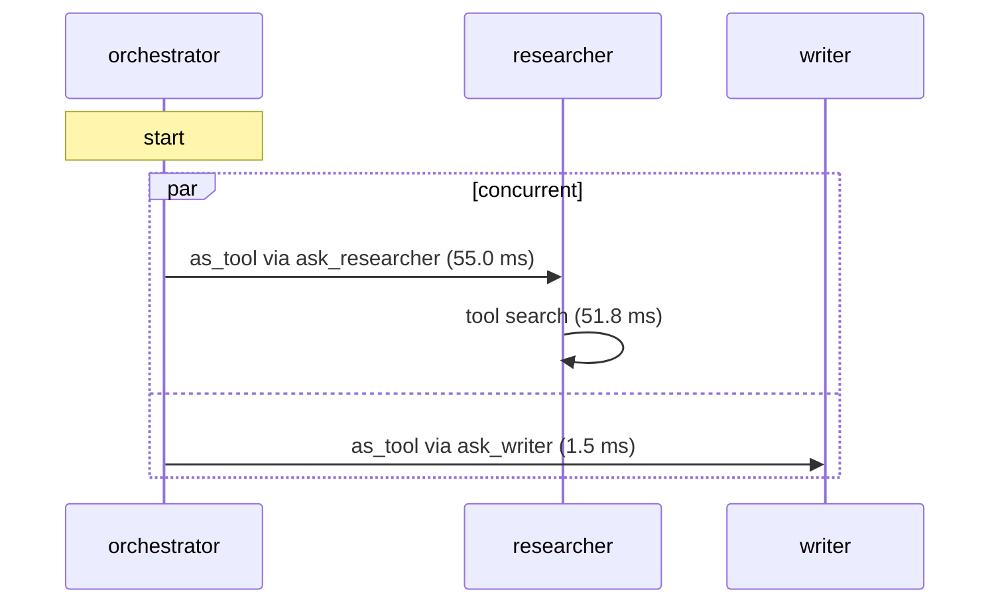
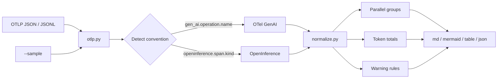

# handoffmap

**English** | [한국어](README.ko.md)

handoffmap folds an OpenTelemetry trace of a multi-agent run (OTel GenAI semantic conventions or OpenInference) into a Mermaid sequence diagram plus a per-agent table: who handed off to whom, who called whom as a tool, what ran in parallel, and how many tokens each agent used. It replaces reading dozens of span-tree lines by eye; paste the result into a PR, issue or README and GitHub renders it as a diagram. It reads an OTLP JSON/JSONL file, needs no server and has zero runtime dependencies. Try it: `uv tool install git+https://github.com/LeeGyeongPil/handoffmap && handoffmap --sample pydantic-ai`.


*Mermaid output (raw text; GitHub renders it as a diagram) of a sample trace built with Pydantic AI. A single `par` block shows that the orchestrator called the researcher and the writer as tools at the same time.*

## What is handoffmap

It is like receiving **one page with an org chart plus a timeline** instead of reading the meeting minutes (the span tree) from start to finish. A trace is a record that lists, as pieces called spans, "this work started and ended at such and such a time". As agents multiply, the pieces become dozens or hundreds, and what you actually want to know are questions like these.

- Did this agent receive its work by a **handoff**, or was it **called like a tool (as tool)**?
- Is the same delegation being repeated?
- Where did work happen at the same time?
- How many tokens did each agent use?

It suits you if:
- You build multi-agent apps with Pydantic AI or the OpenAI Agents SDK (+ OpenInference instrumentation) and want to see why a run behaves oddly
- You want to explain a single run to a colleague or paste it into a PR
- You want to check per-agent tokens in CI (`--format json`)

## Quick start

### Installation

Until it is published to PyPI, install from GitHub.

```bash
curl -LsSf https://astral.sh/uv/install.sh | sh      # uv 가 없다면 (macOS는 brew install uv)
uv tool install git+https://github.com/LeeGyeongPil/handoffmap
# PyPI 에 게시된 뒤에는: pipx install handoffmap
```
(Comments: "if you do not have uv (on macOS, brew install uv)" and "after it is published on PyPI: pipx install handoffmap".)

### Run

Run it right away with the built-in sample (no file, key or network needed).

```bash
handoffmap --sample pydantic-ai
```

````text
## Agent flow: trace 4dc50229 (otel-genai, 11 spans)



### Agents

| agent | runs | LLM calls | tools | input tokens | output tokens | time |
|---|---:|---:|---:|---:|---:|---:|
| orchestrator | 1 | 2 | 2 | 106 | 21 | 67.8 ms |
| researcher | 1 | 2 | 1 | 105 | 11 | 55.0 ms |
| writer | 1 | 1 | 0 | 51 | 1 | 1.5 ms |
| **total** | 3 | 5 | 3 | 262 | 33 | 124.3 ms |

_Tokens are summed from LLM spans only. `time` is the wall time of each run, including work it delegated. `–` means the trace does not contain the value._

_Sample trace: recorded from practice (mock) models, so token counts and timings are made up._
````

If you paste the ` ```mermaid ` block of the output above into a place like GitHub, it is drawn as a diagram. How to read these lines is in "How to read it" below.

> This sample was made with practice (mock) models. The token counts and times are mock values. See "About the sample traces" for details.

## Making your own trace file

handoffmap reads an **OTLP JSON** file (the JSON form of `ExportTraceServiceRequest`) or a **JSONL** with one request per line.

1. **If you use the OpenTelemetry Collector**: it reads the JSONL written by the `file` exporter as it is.
2. **If it is a Python app**: the Python SDK has no OTLP JSON file exporter ([related PR #4996](https://github.com/open-telemetry/opentelemetry-python/pull/4996), checked 2026-11-11). So a short example is provided that collects spans in memory and encodes them itself: [`examples/save_otlp_json.py`](examples/save_otlp_json.py). Just copy the marked part into your app.
3. **If you want to try generating a trace**: there is an example that builds one with mock models and no keys. The required packages are pinned inside the script, so `uv run` installs them for you (there is a lot to download, so the first run may be slow).

```bash
uv run examples/make_pydantic_trace.py trace.json
handoffmap trace.json
```

It can also read traces made with real models (OpenAI and others), but that needs keys, fees and response time, so it is optional. All the examples in this repository use mock models.

## How to read it

Read a line of the Mermaid sequence diagram through three kinds of arrows and the `par` block.

| What you see | Meaning | Control flow |
|---|---|---|
| `a1->>a2: as_tool via ask_researcher` | a1 called a2 through the tool `ask_researcher` | The result returns to the caller |
| `a1->>a2: call` | Another agent is run directly inside an agent, without a tool | The result returns to the caller |
| `a1-)a2: handoff` | a1 **handed off** to a2 (an open arrow) | It does not return |
| `par concurrent … and … end` | A group of activities that overlap in time | Run at the same time |
| `a2->>a2: tool search` | The agent calls an ordinary tool | (can be hidden with `--no-tools`) |

The difference between handoff and as_tool is visible at a glance in the OpenInference sample.

```bash
handoffmap --sample openinference --format mermaid
```

```text
sequenceDiagram
    participant a1 as triage
    participant a2 as billing
    participant a3 as summarizer
    Note over a1: start
    a1-)a2: handoff (4.5 ms)
    par concurrent
        a2->>a2: tool lookup (1.2 ms)
    and
        a2->>a3: as_tool via summarize (1.0 ms)
    end
```


*`triage -) billing` is a handoff that does not return, and `billing ->> summarizer` is an as_tool that returns.*

Seen as a span tree (`Agent workflow` is an unnamed wrapper span), the same trace is 17 lines like this. billing appears only as a **sibling** of triage, so it is hard to notice that it is a handoff.

```text
Agent workflow
  Agent workflow
    triage
      turn
        generation
        handoff to billing
    billing
      turn
        generation
        lookup
        summarize
          Agent workflow
            summarizer
              turn
                generation
      turn
        generation
```

The table columns are as follows.

| Column | Meaning |
|---|---|
| runs | How many times that agent ran (each run is counted separately even under the same name) |
| LLM calls | Number of LLM spans under that agent |
| tools | Number of ordinary tool calls (handoff marker tools are excluded) |
| input / output tokens | Tokens summed from LLM spans only. `–` if the trace has no value |
| time | The wall-clock time of that run (including delegated work) |

```bash
handoffmap --sample pydantic-ai --format table
```


*Total row: 262 input and 33 output tokens.*

## Usage

```text
handoffmap [FILE | --sample NAME] [--format md|mermaid|table|json] [--explain]
           [--trace TRACE_ID] [--max-parallel N] [--repeat-threshold N] [--no-tools] [-o OUT]
```

| Option | What it does | Example |
|---|---|---|
| `FILE` | An OTLP JSON or JSONL file | `handoffmap run.json` |
| `--sample NAME` | A built-in practice trace (`pydantic-ai`, `pydantic-ai-v2`, `pydantic-ai-v6`, `openinference`) | `handoffmap --sample openinference` |
| `--format`, `-f` | Output format: `md` (default), `mermaid`, `table`, `json` | `handoffmap run.json -f json` |
| `--explain` | The detected convention, the grounds for each edge judgment, and the ignored wrappers | `handoffmap run.json --explain` |
| `--trace ID` | Only one trace from a file with several mixed (the full ID or a non-ambiguous prefix) | `--trace 4dc5` |
| `--max-parallel N` | A `wide-parallel` warning if one parallel group has more than N simultaneous activities (default 8) | `--max-parallel 1` |
| `--repeat-threshold N` | A `repeated-delegation` warning if the same delegation happens N times (default 3) | `--repeat-threshold 2` |
| `--no-tools` | Hides ordinary tool-call lines | `--no-tools` |
| `-o`, `--output OUT` | Save to a file | `-o flow.md` |
| `--version` | Show the version | |

Exit codes: `0` normal / `1` no agent spans / `2` input error (not OTLP, or file missing).

```text
$ handoffmap not-otlp.json
handoffmap: not an OTLP trace: expected a JSON object with a 'resourceSpans' list      (종료 코드 2)
```
(`종료 코드 2` means "exit code 2".)

**Scenario 1 - Paste into a PR**

```bash
handoffmap run.json > flow.md
```
If you paste the contents of `flow.md` into the PR description, the Mermaid block is drawn as a diagram and the table appears with it.

**Scenario 2 - Check the grounds**

```bash
handoffmap --sample openinference --explain
```

```text
trace: c9c642518c7203aee90e7f8c52f974ad
convention: openinference
size: 17 spans, 3 agent runs, 3 agents
agents: triage, billing, summarizer
edges:
  (none) -> triage: root  [no agent above it and no handoff source: it started the run]
  triage -> billing: handoff  [no agent ancestor; the span is a sibling and names its predecessor (graph.node.parent_id)]
  billing -> summarizer: as_tool via summarize  [a tool span sits between the caller and this agent (agent used as a tool)]
ignored wrappers (AGENT span without agent.name, not counted as agents): 'Agent workflow' x1
tokens: none of the LLM spans carry token counts
```
(The normal report follows this.) You can see the detected convention, the number of spans accepted as agents, and the ignored wrappers. This sample has empty token values, so the token cells of the table are `–`.


*The first part of the `--explain` output.*

**Scenario 3 - Repeated-delegation warning**

```bash
handoffmap tests/fixtures/synthetic_loop.otlp.json
```


*A synthetic trace made by hand (not measured). The same delegation repeated 3 times, so a warning was attached, and coder's runs is 3.*

```text
### Warnings

- **repeated-delegation**: planner -> coder happened 3 times (threshold 3); check for a loop or a missing stop condition
```

**Scenario 4 - Check tokens in CI**

```bash
handoffmap --sample pydantic-ai --format json
```
The JSON contains `trace_id`, `convention`, `span_count`, `agents`, `totals`, `edges`, `parallel` and `warnings`. An `agents` entry has `name`, `runs`, `llm_calls`, `tool_calls`, `input_tokens`, `output_tokens`, `cost` and `duration_ms`. You can filter it like `jq '.agents[] | {name, input_tokens}'` (jq is installed separately).

**Python API**

```python
import handoffmap

trace = handoffmap.load("src/handoffmap/samples/pydantic_ai_v5.otlp.json")[0]
flow = handoffmap.analyze(trace)
for e in flow.edges:
    print(e.caller, "->", e.callee, e.kind, e.via)
print(handoffmap.render_table(flow))
```

```text
None -> orchestrator root None
orchestrator -> researcher as_tool ask_researcher
orchestrator -> writer as_tool ask_writer
| agent | runs | LLM calls | tools | input tokens | output tokens | time |
|---|---:|---:|---:|---:|---:|---:|
| orchestrator | 1 | 2 | 2 | 106 | 21 | 67.8 ms |
| researcher | 1 | 2 | 1 | 105 | 11 | 55.0 ms |
| writer | 1 | 1 | 0 | 51 | 1 | 1.5 ms |
| **total** | 3 | 5 | 3 | 262 | 33 | 124.3 ms |
```

Installation: to use it as a library, add it to your project with `uv add git+https://github.com/LeeGyeongPil/handoffmap` (or `pip install git+https://github.com/LeeGyeongPil/handoffmap`). `uv tool install` is an isolated environment, so `import handoffmap` does not work there. The sample path in the example above (`src/handoffmap/samples/...`) is correct only when run from the root of a cloned repository.

Public names: `load`, `parse`, `analyze`, `render_mermaid`, `render_table`, `render_markdown`, `to_dict`, the exception `HandoffmapError` (`NotOtlpError`, `NoAgentSpansError`) and the data types (`Trace`, `Flow`, `Edge`, etc.). The same code is in [`examples/api_demo.py`](examples/api_demo.py) (run `uv run python examples/api_demo.py` from the repository root).

Message contents (prompt and response bodies such as `gen_ai.input.messages`) are never included in any output format.

## Configuration

There are no configuration files, environment variables or API keys. The tool only reads files and does not use the network. The only things you can adjust are the options above (`--max-parallel`, `--repeat-threshold`).

## How it decides



1. **Reading**: IDs are accepted as both hex and base64, and span kinds as both integers and `SPAN_KIND_*` names. If several traces are mixed, they are split per trace.
2. **Convention detection**: it decides by attributes, not by span name. This is because the convention is still at the Development stage, so span names differ by framework and version (Pydantic AI instrumentation v2 uses `agent run`, v5 and v6 use `invoke_agent name`). For OTel GenAI it looks at `gen_ai.operation.name` (`invoke_agent`, `execute_tool`, `chat`, etc.), and for OpenInference at `openinference.span.kind` (`AGENT`, `TOOL`, `LLM`) and `agent.name`. An AGENT span with no name (a wrapper) is not counted as an agent.
3. **Edge kind decided by ancestor search**: from an agent run, it walks up the parent chain.
   - If it meets a tool span while climbing, it is `as_tool`; if it reaches an agent ancestor without meeting one, it is `call`.
   - If there is no agent ancestor and `graph.node.parent_id` exists, it is a `handoff` (sibling span).
   - If neither, it is `root`.
   - If the chain is broken because a parent span was not exported, it looks instead by time containment.
4. **Parallel detection**: parallelism is not visible in the tree, so it is found by time. If the time intervals of activities under the same agent run (sub-agents and ordinary tools) overlap, they form one group. If an end time equals a start time, it is not an overlap.
5. **Tokens are summed from LLM spans only**: agent spans can also carry total attributes (`gen_ai.usage.*`, `gen_ai.aggregated_usage.*`), but adding them would count sub-calls twice (double counting) or drop the sub-calls. Only the smallest unit, the LLM call, is added once and attributed to the nearest agent run. That is why the sample gives 262/33. The total attributes are used only as cross-check values in `--explain`.
6. **Warnings**: `repeated-delegation` if the same caller→target delegation happens N or more times, and `wide-parallel` if the simultaneous activities of one group exceed the limit.

## Supported convention snapshot

Conventions can change, so the reference date is given (checked 2026-11-11).

| Target | Reference |
|---|---|
| OTel GenAI semantic conventions | The [semantic-conventions-genai](https://github.com/open-telemetry/semantic-conventions-genai) repository, Development status |
| OpenInference | [semantic conventions spec](https://github.com/Arize-ai/openinference/blob/main/spec/semantic_conventions.md), 0.1.43 |
| Versions the samples were made with | pydantic-ai-slim 2.67.0, openai-agents 0.24.0, openinference-instrumentation-openai-agents 2.7.1 |

| Pydantic AI instrumentation version | Span names | handoffmap result |
|---|---|---|
| v2 | `agent run`, `running tool` | Same structure (time values differ) |
| v5 | `invoke_agent name`, `execute_tool name` | Reference |
| v6 | Same as v5 (only retry-message handling differs) | Same structure (time values differ) |

## About the sample traces

The 4 built-in samples are traces made with **practice mock models**. They are real spans produced by real framework instrumentation, but the model responses are predetermined, so the token counts and times are mock values. How they differ from traces made with real models: tokens and times are real values (OpenInference's `llm.token_count.*` could not be confirmed through a real-model path), and response times take longer.

To recreate them (the script fetches and installs the required packages by itself; the first run may be slow):

```bash
uv run examples/make_pydantic_trace.py trace.json
uv run examples/make_openai_agents_trace.py trace.json
```

The sample sources and the versions used to make them are in [`src/handoffmap/samples/SOURCES.md`](src/handoffmap/samples/SOURCES.md).

## Comparison with existing tools (when to use it)

- Use it when: you want to take one file and make Markdown/Mermaid to paste into a PR or issue, you want to see things folded by agent (kind of delegation, parallelism, tokens), or you want to run it in CI without a server.
- Use another tool when: for a dashboard that continuously monitors a running service → [Langfuse](https://langfuse.com/docs/observability/features/agent-graphs), [Arize Phoenix](https://arize.com/docs/ax/observe/tracing-concepts/agent-graphs). To explore the whole span tree in a web UI → [agent-prism](https://github.com/evilmartians/agent-prism), [otel-desktop-viewer](https://github.com/CtrlSpice/otel-desktop-viewer), [otel-tui](https://github.com/ymtdzzz/otel-tui). For what each tool supports, check its own documentation.

## Limits and roadmap

- Input is only OTLP JSON/JSONL (not gRPC or protobuf). Prompt and response contents are not shown.
- Cost is shown only when the trace has `llm.cost.total` (`–` otherwise). There is no model price table yet.
- OpenInference's handoff detection relies on `graph.node.parent_id`, so with other instrumentation it may appear as `root` (check the grounds with `--explain`).
- The Mermaid output's syntax structure (participant aliases, `par`/`end` balance, special-character escaping) is verified by tests, and the built-in sample outputs passed syntax validation with the mermaid 11 parser (11.17.2). Please check the actual diagram rendering once on GitHub.
- Very deep nesting (about 500 or more levels of agents) fails in `md`/`mermaid` drawing with the recursion limit (`RecursionError`). In that case use `--format table` or `json`.
- The time in the `total` row simply sums each run's time, so overlapping delegated sub-work can make it larger than the real wall clock (it does not affect the token and call-count totals). The same goes for `totals.duration_ms` in the JSON.
- If a file with several traces is output with `--format table`/`mermaid`, they are printed one after another without a trace-separating header. Use the `md` format, or pick one with `--trace`.
- The in-memory exporter in `examples/save_otlp_json.py` keeps accumulating spans, so it is not suited to long-running apps.
- With very large traces (thousands of spans), the diagram gets long. You can shorten it with `--no-tools`.
- Plans: a single-HTML lane diagram with no external resources, coding-agent CLI trace support, a model price table (v0.2) / a local OTLP receiver and file exporter (v0.3). No schedule is set.

## Common problems

| Symptom | Cause | Fix |
|---|---|---|
| `not an OTLP trace` (exit code 2) | Not an OTLP JSON that has `resourceSpans` | Use the Collector `file` exporter output or a file saved with `examples/save_otlp_json.py` |
| `no agent spans` (exit code 1) | The trace has no agent spans, or the convention attributes are missing | Check the detection result with `--explain`, and check that the instrumentation emits `gen_ai.operation.name` or `openinference.span.kind` |
| The token cells are `–` | The LLM spans have no token attributes | Check whether the instrumentation emits tokens (the `openinference` sample is this case) |
| An agent name does not show | Unnamed wrapper spans are not counted | Check "ignored wrappers" in `--explain` |
| `file not found` | A path error | Check the path |

## Development and tests

```bash
git clone https://github.com/LeeGyeongPil/handoffmap && cd handoffmap
uv sync
uv run pytest -q
```

72 tests run with no keys or network, using only the built-in samples and synthetic fixtures (`tests/fixtures/README.md` distinguishes measured from synthetic). Please leave bugs and suggestions as issues. The change log is [CHANGELOG.md](CHANGELOG.md).

## Learn more

- [OTel GenAI agent span conventions](https://github.com/open-telemetry/semantic-conventions-genai/blob/main/docs/gen-ai/gen-ai-agent-spans.md)
- [OpenInference semantic conventions](https://github.com/Arize-ai/openinference/blob/main/spec/semantic_conventions.md)

## License and sources

MIT. From the OpenTelemetry and OpenInference conventions it references (Apache-2.0), only attribute names are used. The built-in samples are data made by this project's scripts.
